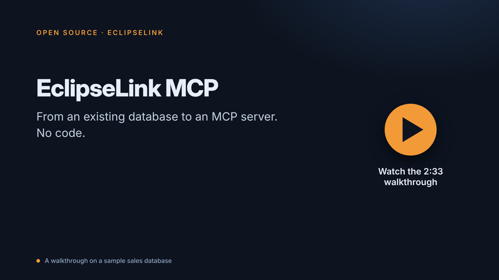

# EclipseLink MCP

[](https://github.com/user-attachments/assets/c88e6dbe-8832-4fbe-9545-ed432ea65f16)

A factory for [MCP](https://modelcontextprotocol.io) servers built on EclipseLink, letting AI agents work with an existing relational database through a mapped object model rather than raw SQL.

Each deployment is a configuration: a database connection and account, a model (generated from the schema as dynamic entities, with no code), named reports and tool settings. The runtime turns that into an MCP server that exposes the model as JSON and XML through MOXy, with typed, relationship-aware tools such as list, describe, find and query.

It is delivered as a **generated, codeless standalone server**: point the runtime at a database and a generated server definition, and you get an MCP server with no code to write. Embedding in existing applications is not planned for now.

A role-based security model (row filters, field visibility and tools per caller) is planned for after the POC.

## Why EclipseLink

- **One model, two bindings.** JPA maps the database; MOXy maps the same entities to JSON/XML and JSON Schema for MCP tool inputs and outputs.
- **Safety by construction.** Agents use mapped entities and a constrained query surface instead of free-form SQL. Access is enforced by the persistence layer (`@AdditionalCriteria`, multitenancy, fetch groups), not by prompts.
- **Better grounding.** Relationships, keys and constraints give a model far more context than a list of tables.

## Status

POC: a working MCP server over stdio, read-only by default, with opt-in named write operations that use optimistic locking. See:

- [docs/requirements.md](docs/requirements.md) for goals, scope and functional/security requirements
- [docs/server-definition.md](docs/server-definition.md) for the server definition: packaging, hosting and the full MCP surface (tools, resources, prompts)
- [docs/open-questions.md](docs/open-questions.md) for decisions made and still to make

## Quick start

Requires Java 21 and Maven.

```sh
mvn package          # builds target/eclipselink-mcp-server-0.1.0-SNAPSHOT.jar and runs the tests
```

The tests create the sample "existing" database, an H2 file at `target/test-db/sales` with customers, products, orders and order lines, plus a read-only `MCP_READER` account and an `MCP_ORDER_DESK` account for the write sample (`samples/order-desk`). To build or reset just that database, without running the tests:

```sh
mvn -Psample-db process-test-resources
```

Both paths run the same script, `src/test/resources/db/sales-db.sql`, and drop and recreate everything each time. To run the sample server against it:

```sh
export SALES_DB_URL="jdbc:h2:file:$PWD/target/test-db/sales;AUTO_SERVER=TRUE"
export SALES_DB_USER=MCP_READER SALES_DB_PASSWORD=reader

# check the definition against the database
java -jar target/eclipselink-mcp-server-0.1.0-SNAPSHOT.jar --definition samples/sales-db --validate

# serve MCP on stdio
java -jar target/eclipselink-mcp-server-0.1.0-SNAPSHOT.jar --definition samples/sales-db
```

Claude Desktop / Claude Code (`mcpServers`):

```json
{
  "mcpServers": {
    "sales-db": {
      "command": "java",
      "args": ["-jar", "/path/to/eclipselink-mcp-server-0.1.0-SNAPSHOT.jar",
               "--definition", "/path/to/EclipseLink-MCP/samples/sales-db"],
      "env": {
        "SALES_DB_URL": "jdbc:h2:file:/path/to/EclipseLink-MCP/target/test-db/sales;AUTO_SERVER=TRUE",
        "SALES_DB_USER": "MCP_READER",
        "SALES_DB_PASSWORD": "reader"
      }
    }
  }
}
```

Use the full path of the JAR that `mvn package` built (`target/eclipselink-mcp-server-0.1.0-SNAPSHOT.jar`); the client reports "Unable to access jarfile" otherwise.

**Several copies of the server.** MCP clients may start more than one copy of a server: Claude Desktop starts one for its chat and more for Cowork and Claude Code sessions. Each copy is its own process, and an embedded H2 file database can be opened by only one process at a time. `;AUTO_SERVER=TRUE` lets them share it: the first process serves the file on a local port and the others connect through it with the same user and password, including the read-only `MCP_READER` account. If the first one exits, the others carry on. Without it, every copy after the first stops with "The H2 database file is in use by another process ... Add ;AUTO_SERVER=TRUE". `init` adds it to H2 file URLs it writes. Client/server databases (PostgreSQL, Oracle and so on) need nothing extra.

### JDBC drivers

Only the H2 driver is bundled in the runtime JAR. For any other database, put its driver JAR in a `drivers/` folder inside the server definition, point `connection.drivers` in the descriptor at a directory, or pass `--drivers <dir>` on the command line (it wins over both). See [server definition 3.3](docs/server-definition.md#33-jdbc-drivers).

```sh
java -jar target/eclipselink-mcp-server-0.1.0-SNAPSHOT.jar --definition ./hr-db --drivers ~/jdbc/postgresql
```

### Credentials

The definition never holds a password. It refers to one: `${env:SALES_DB_PASSWORD}`, or `${file:/run/secrets/sales-db-password}` for a mounted secret. A literal password fails validation. Other sources, such as an OS keychain or a cloud secret manager, are planned as optional resolver plugins. See [spec 5.3](docs/server-definition.md#53-secrets-and-credentials) and the [roadmap](docs/roadmap.md).

### Generate a definition from a database

`init` reads JDBC metadata for the tables you select and writes a starter definition:

```sh
DB_PW=reader java -jar target/eclipselink-mcp-server-0.1.0-SNAPSHOT.jar init \
  --url "jdbc:h2:file:$PWD/target/test-db/sales;AUTO_SERVER=TRUE" --user MCP_READER --password-env DB_PW \
  --table ORDERS --follow-fks 1 --fk-direction both --out /tmp/sales-gen
```

It never scans a whole database unless asked (`--include '*'`). Tables come from names, glob or regex patterns, schemas, table types and foreign key expansion, on the command line or in a `selection.yaml`. See [spec section 7](docs/server-definition.md#7-generating-a-starter-definition-init).

### Refine it, with or without the skill

`edit` makes validated model changes (rename, remove, unlink, describe), and `call` prints the JSON a tool returns:

```sh
java -jar target/eclipselink-mcp-server-0.1.0-SNAPSHOT.jar edit --definition /tmp/sales-gen rename-entity Orders Order
java -jar target/eclipselink-mcp-server-0.1.0-SNAPSHOT.jar call --definition /tmp/sales-gen find_entity '{"entity":"Order","id":1001}'
```

The Claude skill [`skills/configure-server-from-schema`](skills/configure-server-from-schema/SKILL.md) drives the whole loop with you: table selection, `init`, simplification, then named queries and reports. To use it, copy the folder to `~/.claude/skills/` or to a project's `.claude/skills/`.

[samples/](samples/README.md) has both ends of that loop for the sample database: the raw `init` output in `sales-db-generated` (kept current by a golden test) and the shaped `sales-db`.

### What the POC serves

The sample definition ([samples/sales-db](samples/sales-db)) is a descriptor, an ORM XML of dynamic entities, two named reports and one named query. From that the server exposes:

- tools `list_entities`, `describe_entity`, `find_entity`, `query_entities` (structured filters, select paths, sorting, paging, optional count), and `report_sales_by_region` and `report_open_orders_by_customer` (EclipseLink `ReportQuery`, parameters and paging only), and `query_order_details` (orders with their customer and lines, loaded and shaped by the query's `graph`);
- related data loaded by IN batch reads, one statement per relationship level per page, and to-one references read from foreign keys with no lazy loads ([spec 4.8](docs/server-definition.md#48-loading-related-data-and-json-shapes));
- resources `eclipselink://model`, `eclipselink://entity/{name}`, `eclipselink://report/{name}` and `eclipselink://query/{name}`;
- generated server instructions, read-only and destructive tool annotations, agent-facing error codes and an audit log line per call (stderr).

### Not in the POC yet

Compared with [the spec](docs/server-definition.md): JSON is produced from the EclipseLink mappings directly, with the default shape, not yet through MOXy bindings (so `model.bindings` overrides are rejected); no prompts or completions; no `model.schema`; paging cursors are offsets; no HTTP transport; only the first design-time skill (the sample ORM XML is hand-written; `init` generates a starter one).

## Stack

Java 21, Maven, EclipseLink 5.0.2 (dynamic persistence), the official [MCP Java SDK](https://github.com/modelcontextprotocol/java-sdk) 2.2.0 core (no Spring), Jackson 3 for YAML, H2 for the sample and tests.

## License

Dual-licensed under the [Eclipse Public License 2.0](https://www.eclipse.org/legal/epl-2.0) or the [Eclipse Distribution License 1.0](https://www.eclipse.org/org/documents/edl-v10.php), the same as EclipseLink (`SPDX-License-Identifier: EPL-2.0 OR BSD-3-Clause`). See [LICENSE.md](LICENSE.md) and [NOTICE.md](NOTICE.md).
