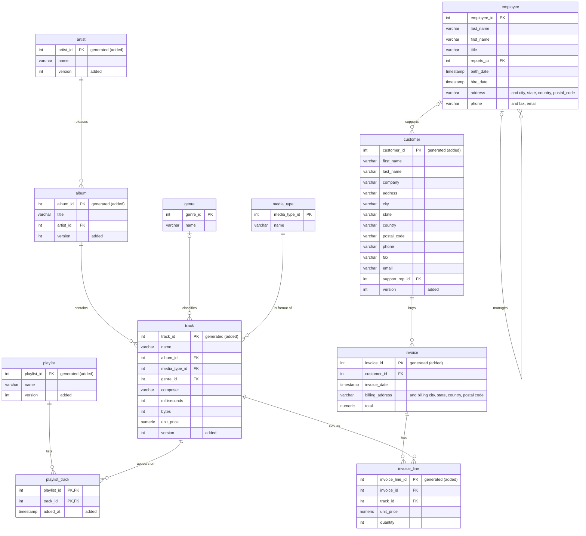

# Chinook music store

A complete, read-write EclipseLink MCP server over [Chinook](https://github.com/lerocha/chinook-database), the
well-known sample database of a digital music store: artists, albums and tracks; customers, invoices and the
employees who support them; playlists. It runs on PostgreSQL, and the tests run it on H2.

This sample stands on its own: everything it uses is in this folder, plus the runtime JAR.

| Folder or file | What it is |
|---|---|
| [db/setup-postgresql.sh](db/setup-postgresql.sh) | Downloads Chinook, checks it, and creates the `chinook` database on PostgreSQL |
| [db/chinook-mcp-postgresql.sql](db/chinook-mcp-postgresql.sql) | What a DBA adds so agents can write safely: lock versions, generated keys, two accounts |
| [db/chinook-mcp-h2.sql](db/chinook-mcp-h2.sql) | The same changes for the H2 copy the tests build |
| [chinook-generated](chinook-generated) | The raw `init` output for all 11 tables, untouched. A golden test keeps it current. |
| [shape-music-store.sh](shape-music-store.sh) | The validated `edit` commands that turn that output into the music-store model |
| [music-store](music-store) | The finished server: the shaped model, 5 named reports, 4 named queries and 14 write operations |

## The database

Chinook models an online music store in the style of iTunes. Each table is a noun in the store, connected by
foreign keys:



The diagram shows the PostgreSQL port that this sample loads, with its snake_case names. Columns marked
"added" are not in upstream Chinook: [db/chinook-mcp-postgresql.sql](db/chinook-mcp-postgresql.sql) adds them
(see [What the sample adds to Chinook](#what-the-sample-adds-to-chinook)). The SQLite tutorial has the
[original diagram](https://www.sqlitetutorial.net/sqlite-sample-database/) of the SQLite version, whose names
are plural and CamelCase (`albums`, `AlbumId`).

The 1.4.5 data: 275 artists, 347 albums, 3,503 tracks in 25 genres and 5 media types, 59 customers, 8 employees,
412 invoices with 2,240 lines (2021 to 2025), and 18 playlists.

## Set it up

You need Java 21 and Maven 3.9.10 or later (on a Mac: `brew install openjdk@21 maven`), and either a PostgreSQL
server or nothing at all (H2, below). Run every command from the repository root, in one terminal (bash or zsh).
Once it is set up, go to [Run it](#run-it); [How it was made](#how-it-was-made) is background.

### PostgreSQL

**1. Build the server and fetch the PostgreSQL driver**, which the runtime does not bundle:

```sh
mvn -q package -DskipTests                                 # builds target/eclipselink-mcp-server-*.jar
mvn -q dependency:copy -Dartifact=org.postgresql:postgresql:42.7.4 -DoutputDirectory=target/chinook/drivers
```

**2. A PostgreSQL server you can reach as a superuser**, version 14 or later, with `psql` on your `PATH`. Any of:

```sh
# Homebrew on a Mac. The superuser is your macOS user, so leave out PGUSER below.
brew install postgresql@16
brew services start postgresql@16
export PATH="$(brew --prefix postgresql@16)/bin:$PATH"

# Docker. The superuser is postgres, with the password you choose here.
docker run -d --name chinook-db -p 5432:5432 -e POSTGRES_PASSWORD=postgres postgres:17
export PGUSER=postgres PGPASSWORD=postgres
```

The Docker container has its own `psql`, but the script runs yours, so install one too (on a Mac,
`brew install libpq` and put `$(brew --prefix libpq)/bin` on your `PATH`).

**3. Create the database**, about five seconds:

```sh
PGHOST=localhost sh samples/chinook/db/setup-postgresql.sh
```

Run it again whenever you want the shipped data back. The AdventureWorks sample can share the server: both use an
`mcp_reader` account with the same password, which the scripts create only if it is missing.

`setup-postgresql.sh`:

1. downloads `Chinook_PostgreSql.sql` from the upstream [v1.4.5 tag](https://github.com/lerocha/chinook-database/tree/v1.4.5)
   into `target/chinook/` once, and stops unless its SHA-256 is
   `e3fde5c1a5b51a2a91429a702c9ca6e69ba56e6c7f5e112724d70c3d03db695e`;
2. runs it, which drops and recreates the `chinook` database;
3. runs `chinook-mcp-postgresql.sql`.

Chinook itself is never committed to this repository. Only the EclipseLink MCP JAR is needed at run time, plus
the PostgreSQL JDBC driver, which the runtime does not bundle; `--drivers` points at it.

### H2, without a database server

`mvn test` builds the same database as an H2 file at `target/test-db/chinook`, from the same download, so you can
try the sample with no PostgreSQL server. H2 runs the PostgreSQL script in `MODE=PostgreSQL;DATABASE_TO_LOWER=TRUE`,
so names match PostgreSQL's (see `ChinookDatabase` in the tests for the two small changes it makes on the way in).

```sh
mvn test -Dtest=ChinookSampleTest
export CHINOOK_DB_URL="jdbc:h2:file:$PWD/target/test-db/chinook;MODE=PostgreSQL;DATABASE_TO_LOWER=TRUE;AUTO_SERVER=TRUE"
```

With `CHINOOK_DB_URL` set, leave out `--drivers` below: H2 is bundled.

## How it was made

This is the flow the [configure-server-from-schema](../../skills/configure-server-from-schema/SKILL.md) skill
drives with a data owner, done once and recorded.

**1. Make the database writable safely.** Upstream Chinook has no optimistic lock versions and no generated keys,
so agents could only read it. [What the sample adds](#what-the-sample-adds-to-chinook) lists the changes.

**2. Generate.** `init` reads the schema through the read-only account and writes a starter definition for every
table ([chinook-generated](chinook-generated), with its own README listing entities and relationships). It finds
the five `version` columns and the seven identity keys by itself.

```sh
export CHINOOK_DB_PASSWORD=reader
java -jar target/eclipselink-mcp-server-*.jar init \
  --url jdbc:postgresql://localhost:5432/chinook --user mcp_reader --password-env CHINOOK_DB_PASSWORD \
  --drivers target/chinook/drivers --name chinook --include '*' --out samples/chinook/chinook-generated
```

`ChinookSampleTest` runs the same command against H2 and fails on any difference from the committed folder, apart
from the URL it records. With `CHINOOK_PG_URL=jdbc:postgresql://localhost:5432/chinook` and
`CHINOOK_PG_DRIVERS=target/chinook/drivers` set, it also runs it against PostgreSQL and expects the folder exactly.

**3. Shape the model.** [shape-music-store.sh](shape-music-store.sh) is the list of `edit` commands: keys renamed to
`id`; `Employee.employee` and `employees` renamed to `reportsTo` and `directReports`, `Invoice.invoiceLines` to
`lines`, `Playlist.playlistTracks` to `tracks`; reverse one-to-manys nobody navigates removed (a genre's 1,297
tracks); employees' birth dates and everyone's fax numbers removed; `PlaylistTrack` locked through its playlist;
and descriptions added. Each edit is validated against the database and undone if it breaks anything. The model in
[music-store/model](music-store/model) is the script's output, with the licence header added.

```sh
DRIVERS=target/chinook/drivers sh samples/chinook/shape-music-store.sh    # writes target/chinook/music-store
```

**4. Reports, queries and writes.** The YAML files in [music-store](music-store) under `reports/`, `queries/` and
`writes/`, and `tools.writes` in its descriptor.

## Run it

```sh
export CHINOOK_DB_PASSWORD=store        # mcp_store: the account allowed only the sample's changes
JAR=$(ls target/eclipselink-mcp-server-*.jar | grep -v original)
java -jar "$JAR" --definition samples/chinook/music-store --drivers target/chinook/drivers --validate
java -jar "$JAR" call --definition samples/chinook/music-store --drivers target/chinook/drivers \
  report_top_artists '{"pageSize":5}'
```

`report_top_artists` prints the five artists with the most tracks, Iron Maiden first with 213. Next, try the
read tools in [What agents can do](#what-agents-can-do), and the writes, conflicts and constraint violation in
[Write](#write); they run as dry runs unless you add `--commit`. After a `--commit`, run step 3 again to reset.

**Claude Desktop:** add the server to `~/Library/Application Support/Claude/claude_desktop_config.json` (Settings,
Developer, Edit Config), then quit and reopen Claude Desktop. Desktop does not read your shell's `PATH`, so give
the full path to `java` (`/opt/homebrew/opt/openjdk@21/bin/java` with Homebrew), the JAR, the definition and the
drivers:

```json
{
  "mcpServers": {
    "chinook": {
      "command": "/opt/homebrew/opt/openjdk@21/bin/java",
      "args": ["-jar", "/path/to/EclipseLink-MCP/target/eclipselink-mcp-server-0.1.0-SNAPSHOT.jar",
               "--definition", "/path/to/EclipseLink-MCP/samples/chinook/music-store",
               "--drivers", "/path/to/EclipseLink-MCP/target/chinook/drivers"],
      "env": { "CHINOOK_DB_PASSWORD": "store" }
    }
  }
}
```

**Claude Code**, from the repository root:

```sh
claude mcp add chinook -e CHINOOK_DB_PASSWORD=store -- java -jar "$PWD/$JAR" \
  --definition "$PWD/samples/chinook/music-store" --drivers "$PWD/target/chinook/drivers"
```

The descriptor defaults to `jdbc:postgresql://localhost:5432/chinook` as `mcp_store`; `CHINOOK_DB_URL` and
`CHINOOK_DB_USER` override them.

## What agents can do

### Read

The four built-in tools work on every entity: `list_entities`, `describe_entity`, `find_entity` and
`query_entities` (filters, select paths, sorting, paging). The named tools answer common questions in one call:

| Tool | Answers |
|---|---|
| `report_top_artists` | Artists with the most tracks (`pageSize` for a top N) |
| `report_album_summary` | Per album: tracks, total and average length, total size; optionally one `genre` |
| `report_sales_by_country` | Invoices and sales per billing country, for a date range |
| `report_sales_by_genre` | Copies sold per genre, for a date range |
| `report_sales_by_support_rep` | Sales of each support agent's customers, for a date range |
| `query_album_tracks` | Albums by artist name or pattern, with their tracks, genre and media type |
| `query_customer_invoices` | One customer's invoices, newest first, with lines, tracks and albums |
| `query_playlist_tracks` | Playlists by name or pattern, with their version and tracks |
| `query_org_chart` | Employees with their manager, direct reports and customers |

Amounts come back as strings (`"0.99"`), and dates as ISO-8601, by the fixed type contract.

### Write

| Entity | Allowed | Tools | Lock |
|---|---|---|---|
| Customer | create, update | `create_customer`, `update_customer` | `version` |
| Invoice | create | `create_invoice` (with its lines) | none needed: a new invoice cannot conflict, and an issued one never changes |
| Artist | create, update | `create_artist`, `update_artist` | `version` |
| Album | create, update | `create_album` (with its tracks), `update_album` | `version` |
| Track | create, update | `add_track`, `update_track` | `version` |
| Playlist | create, update, delete | `create_playlist`, `update_playlist`, `delete_playlist` | `version` |
| PlaylistTrack | create, delete | `add_playlist_track`, `remove_playlist_track` | through its playlist |

Employees, genres, media types and invoice lines are read-only: they are not listed under `tools.writes`.

What the operations show:

- **A parent with its children in one transaction.** `create_invoice` takes a customer and its lines and creates
  them together. `create_album` does the same for an album and its tracks. The database assigns every id.
- **Snapshots.** Each invoice line copies the track's current price, and the invoice copies the customer's current
  address, so repricing a track or moving a customer later does not change past invoices.
- **Totals.** The invoice total is the sum of quantity × unit price over its lines.
- **Optimistic locking with no server state.** Every item carries its `version`; an update passes it back and gets
  the new one. A stale version gets `CONFLICT`, with the read to make before deciding, with the user, whether the
  change is a duplicate, a conflict, or still applies.
- **Locking through a parent.** A playlist entry has no version of its own. Adding or removing one checks and
  increments the playlist's version (`playlistVersion`), so two people editing the same playlist cannot both win.
- **The database has the last word.** Deleting a playlist that still has tracks gets `CONSTRAINT_VIOLATION`.

`call` runs write tools as a dry run, rolled back, unless you pass `--commit`:

```sh
C() { java -jar "$JAR" call --definition samples/chinook/music-store --drivers target/chinook/drivers "$@"; }   # bash and zsh
C create_invoice '{"customer":2,"lines":[{"track":1,"quantity":1},{"track":2,"quantity":2}]}'
C update_track '{"id":1,"version":1,"unitPrice":"1.29"}'          # new price; sold lines keep 0.99
C add_playlist_track '{"playlistId":18,"trackId":1,"playlistVersion":1}'
C add_playlist_track '{"playlistId":18,"trackId":1,"playlistVersion":0}'   # CONFLICT: read the playlist again
C remove_playlist_track '{"id":{"playlistId":18,"trackId":597},"playlistVersion":1}'
C delete_playlist '{"id":18,"version":1}'                          # CONSTRAINT_VIOLATION: it has a track
```

### Entity kinds and tenancy

Recorded here until the runtime supports `set-kind` (roadmap K1); until then every entity is read fresh from the
database on each call, which is always safe.

| Entity | Kind | Why |
|---|---|---|
| Genre, MediaType | `reference` | Changed only by a release of the catalog |
| Employee | `external` | Changed by the HR system, never by agents |
| Customer, Invoice, Artist, Album, Track, Playlist, PlaylistTrack | `writable` | Agents change them through this server |

Chinook is one store, so nothing is multitenant.

## The SQLite tutorial, lesson by lesson

The [SQLite Tutorial](https://www.sqlitetutorial.net/) teaches SQL with Chinook. An MCP server deliberately does not
accept SQL, so this is how each lesson's question is asked here, and where it cannot be. "query_entities" means
the built-in tool with a filter, `select`, `orderBy` and paging.

| Lesson | Here |
|---|---|
| [SELECT](https://www.sqlitetutorial.net/sqlite-select/) | `query_entities` with `select: ["id","name","composer","unitPrice"]` on `Track` |
| [ORDER BY](https://www.sqlitetutorial.net/sqlite-order-by/) | `orderBy` in `query_entities`, reports and queries |
| [SELECT DISTINCT](https://www.sqlitetutorial.net/sqlite-distinct/) | A report with `groupBy` and no aggregates; not ad hoc |
| [Column and table aliases](https://www.sqlitetutorial.net/sqlite-tutorial/sqlite-column-aliases-and-table-aliases/) | `as` in report columns; mapped attribute names replace column names everywhere |
| [WHERE](https://www.sqlitetutorial.net/sqlite-where/), [AND](https://www.sqlitetutorial.net/sqlite-and-operator/), [OR](https://www.sqlitetutorial.net/sqlite-or-operator/) | The filter grammar: `and`, `or`, `not` over `eq`, `ne`, `lt`, `le`, `gt`, `ge` |
| [LIMIT](https://www.sqlitetutorial.net/sqlite-limit/) | `pageSize` and the returned `nextCursor`, capped by `limits.maxPageSize` |
| [BETWEEN](https://www.sqlitetutorial.net/sqlite-between/) | `between`, or `ge` and `lt` as in the sales reports' date ranges |
| [IN](https://www.sqlitetutorial.net/sqlite-in/) | `in` and `notIn` with a list of values (not a subquery) |
| [LIKE](https://www.sqlitetutorial.net/sqlite-like/) | `like`, as in `query_album_tracks` (`"Led%"`) |
| [GLOB](https://www.sqlitetutorial.net/sqlite-glob/) | Not covered: SQLite-specific; use `like` |
| [IS NULL](https://www.sqlitetutorial.net/sqlite-is-null/) | `isNull` and `isNotNull`, e.g. tracks with no composer |
| [JOIN](https://www.sqlitetutorial.net/sqlite-join/), [INNER JOIN](https://www.sqlitetutorial.net/sqlite-inner-join/) | Paths through relationships: `album.artist.name` in a filter, `select`, report or query `graph` |
| [LEFT JOIN](https://www.sqlitetutorial.net/sqlite-left-join/) | Relationships in a `graph` or `select` keep rows with no match (`genre: null`); `joins: { path: outer }` in a report |
| [RIGHT JOIN](https://www.sqlitetutorial.net/sqlite-right-join/), [FULL OUTER JOIN](https://www.sqlitetutorial.net/sqlite-full-outer-join/) | Not covered: start from the other entity instead |
| [CROSS JOIN](https://www.sqlitetutorial.net/sqlite-cross-join/) | Not covered: no relationship to follow, by design |
| [SELF JOIN](https://www.sqlitetutorial.net/sqlite-self-join/) | `Employee.reportsTo` and `directReports`: `query_org_chart` |
| [GROUP BY](https://www.sqlitetutorial.net/sqlite-group-by/) | Named reports: `report_album_summary` is the lesson's tracks per album, with sum, min/max/avg of length and size |
| [HAVING](https://www.sqlitetutorial.net/sqlite-having/) | Not yet: reports filter rows before grouping, not groups after it. "Albums with more than 15 tracks" is `report_album_summary` sorted by `trackCount`. |
| [UNION](https://www.sqlitetutorial.net/sqlite-union/), [EXCEPT](https://www.sqlitetutorial.net/sqlite-except/), [INTERSECT](https://www.sqlitetutorial.net/sqlite-intersect/) | Not covered: one entity per call; agents combine results themselves |
| [Subquery](https://www.sqlitetutorial.net/sqlite-subquery/) | Usually a path: "tracks of the album 'Let There Be Rock'" is a filter on `album.title`; "customers supported by employees in Canada" is a filter on `supportRep.country`. Subqueries in `FROM` or `SELECT` are not covered. |
| [Correlated subquery](https://www.sqlitetutorial.net/sqlite-subquery/), [EXISTS](https://www.sqlitetutorial.net/sqlite-exists/) | Mostly a report: "albums under 10 MB" is `report_album_summary` by `totalBytes`. No ad hoc EXISTS. |
| [CASE](https://www.sqlitetutorial.net/sqlite-case/) | Not covered: no computed columns |
| [INSERT](https://www.sqlitetutorial.net/sqlite-insert/) | `create_*` write operations: one named operation per scenario, never a free-form insert |
| [UPDATE](https://www.sqlitetutorial.net/sqlite-update/) | `update_*` operations: only the attributes listed, with the `version` read |
| [DELETE](https://www.sqlitetutorial.net/sqlite-delete/) | `delete_playlist`, `remove_playlist_track`; nothing else can be deleted |
| [REPLACE](https://www.sqlitetutorial.net/sqlite-replace-statement/), [UPSERT](https://www.sqlitetutorial.net/sqlite-upsert/) | Not covered, by design: a create of an existing key gets `ALREADY_EXISTS`, and an update needs the version read |
| [RETURNING](https://www.sqlitetutorial.net/sqlite-returning/) | Every write returns the row as written, with its generated id and new version |
| [Transaction](https://www.sqlitetutorial.net/sqlite-transaction/) | Each write call is one transaction, including an invoice with its lines; `call` without `--commit` rolls back |
| [Aggregate functions](https://www.sqlitetutorial.net/sqlite-avg/) (avg, count, max, min, sum) | `aggregate:` in named reports |

The lessons on creating and altering tables, views, indexes, triggers and full-text search are about the database
itself, not about reading or changing its data, so they have no counterpart here.

## What the sample adds to Chinook

[db/chinook-mcp-postgresql.sql](db/chinook-mcp-postgresql.sql) (and its H2 twin) changes upstream Chinook as a
DBA would before letting agents write:

- an integer `version` column, starting at 1, on `artist`, `album`, `track`, `customer` and `playlist`;
- `playlist_track.added_at`, so adding a track to a playlist records when (empty for the shipped playlists);
- database-generated keys on `artist`, `album`, `track`, `customer`, `invoice`, `invoice_line` and `playlist`,
  starting after the shipped data;
- two accounts: `mcp_reader` (password `reader`), which may only read and which `init` uses, and `mcp_store`
  (password `store`), which may also insert into, update or delete from exactly the tables the write operations
  change. The passwords are the sample's: use your own for anything but a local try-out.

## Sources and licences

| What | Where | Licence | How it is used |
|---|---|---|---|
| Chinook database 1.4.5, by Luis Rocha | [lerocha/chinook-database](https://github.com/lerocha/chinook-database), [`Chinook_PostgreSql.sql` at v1.4.5](https://github.com/lerocha/chinook-database/blob/v1.4.5/ChinookDatabase/DataSources/Chinook_PostgreSql.sql) | [MIT](https://github.com/lerocha/chinook-database/blob/v1.4.5/LICENSE.md) | Downloaded at setup and checked by SHA-256; not copied into this repository |
| SQLite Tutorial | [sqlitetutorial.net](https://www.sqlitetutorial.net/), [sample database page and diagram](https://www.sqlitetutorial.net/sqlite-sample-database/) | Not stated | Linked for its lessons and diagram; nothing copied. The diagram above is drawn for this sample. |
| mcp-chinookdb-server, by Andrew Gordon | [andrewwgordon/mcp-chinookdb-server](https://github.com/andrewwgordon/mcp-chinookdb-server) | Not stated | Read as an example: it downloads Chinook when needed and exposes a free-form SQL tool. No code used. |
| PostgreSQL JDBC driver | [pgjdbc](https://jdbc.postgresql.org/) | [BSD-2-Clause](https://jdbc.postgresql.org/license/) | Downloaded by you (`mvn dependency:copy`); not bundled |
| H2 Database | [h2database.com](https://www.h2database.com/) | [MPL 2.0 or EPL 1.0](https://www.h2database.com/html/license.html) | The runtime's bundled driver; runs the test copy |

The sample's own files (scripts, definitions, tests) are under this repository's licence, EPL-2.0 OR BSD-3-Clause,
and carry its header, apart from `chinook-generated`, which is `init` output.
